

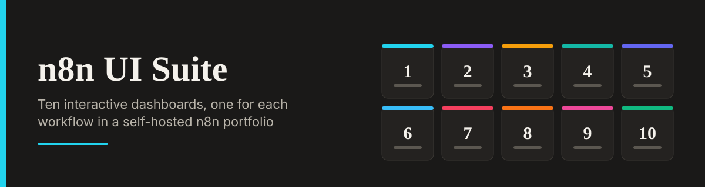

# n8n UI Suite

A collection of 10 premium React dashboards that serve as the UI layer for a self-hosted n8n automation portfolio. Each app visualizes the logic, edge cases, and failure modes of a specific backend workflow.

- **Live Portfolio:** [hensonbrix-portfolio.vercel.app](https://hensonbrix-portfolio.vercel.app)
- **Backend Repository:** [platform-integration-portfolio](https://github.com/Xhenzouu/platform-integration-portfolio)

## Why This Exists

Most automation portfolios show screenshots of n8n canvases. This suite turns each workflow into a fully interactive, production-grade dashboard, so a visitor can interact with the logic directly and see how each workflow behaves when things go wrong.

## Gallery

Click any screenshot to open the live demo.

<table>
  <tr>
    <td width="50%" align="center"><a href="https://lead-enrichment-pipeline.lovable.app">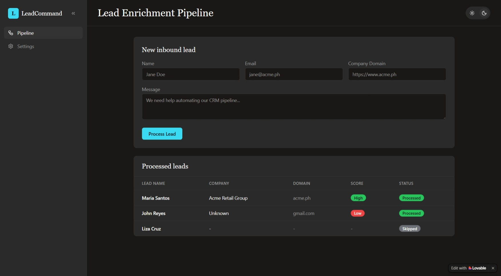</a> <b>1. Lead Enrichment Pipeline</b></td>
    <td width="50%" align="center"><a href="https://triagedesk.lovable.app">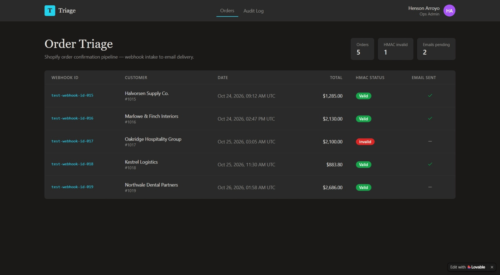</a> <b>2. Triagedesk</b></td>
  </tr>
  <tr>
    <td width="50%" align="center"><a href="https://getsync-command.lovable.app">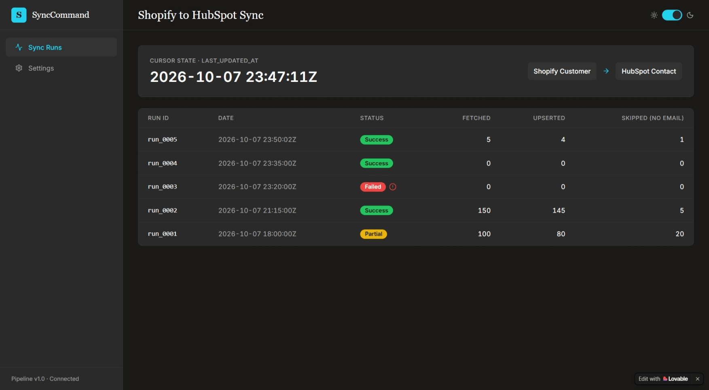</a> <b>3. GetSync Command</b></td>
    <td width="50%" align="center"><a href="https://airtable-notion-diff.lovable.app">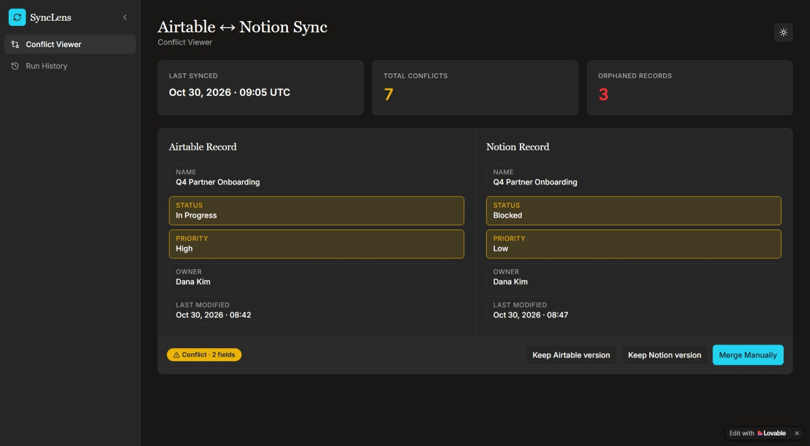</a> <b>4. Airtable Notion Diff</b></td>
  </tr>
  <tr>
    <td width="50%" align="center"><a href="https://stripe-fanout.lovable.app">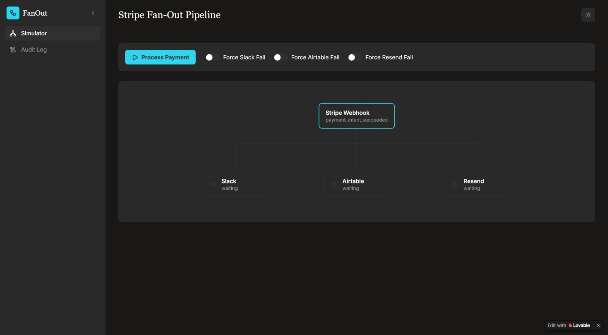</a> <b>5. Stripe FanOut</b></td>
    <td width="50%" align="center"><a href="https://google-slack-sync.lovable.app">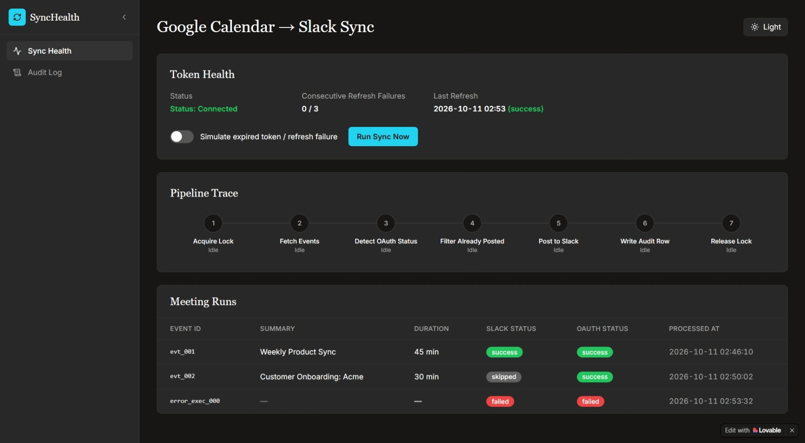</a> <b>6. SyncHealth</b></td>
  </tr>
  <tr>
    <td width="50%" align="center"><a href="https://data-ingest.lovable.app">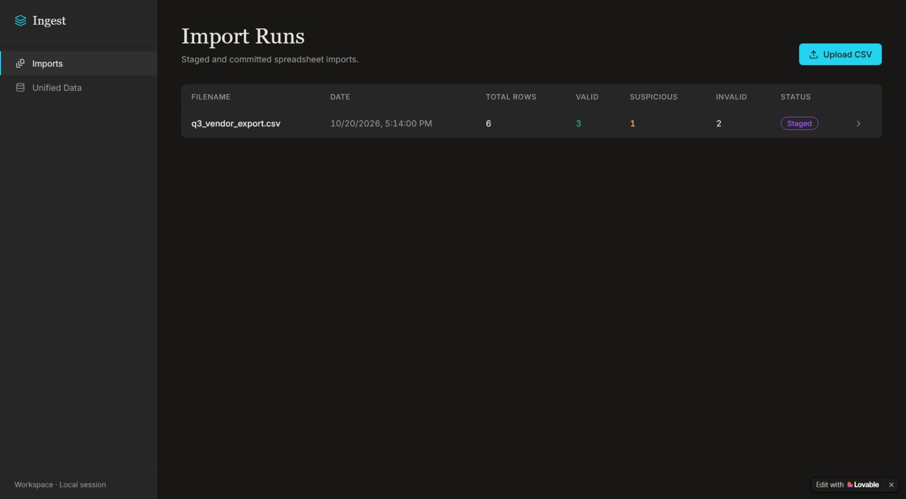</a> <b>7. Data Ingest</b></td>
    <td width="50%" align="center"><a href="https://canvas-deadlines.lovable.app">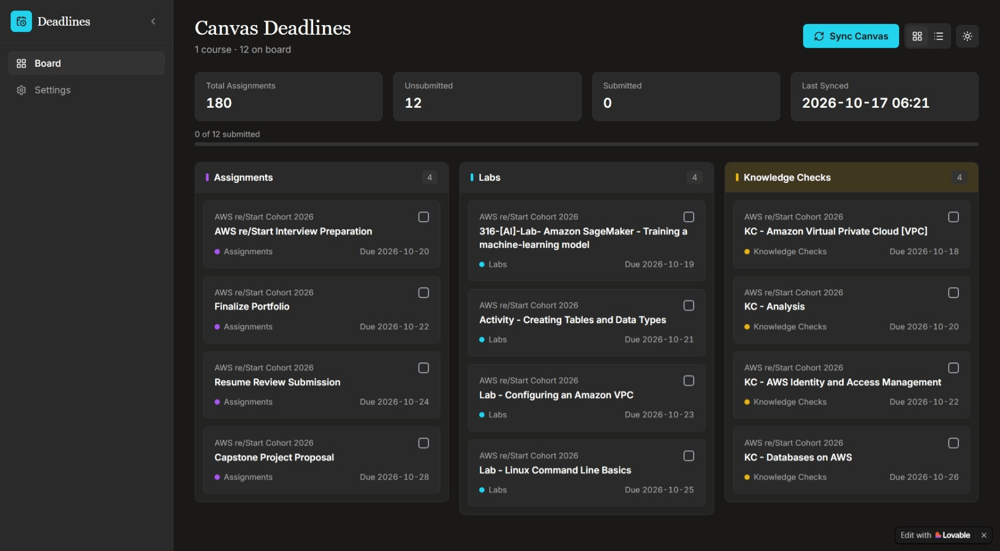</a> <b>8. Canvas Deadlines</b></td>
  </tr>
  <tr>
    <td width="50%" align="center"><a href="https://routeway-multi-tenant.lovable.app">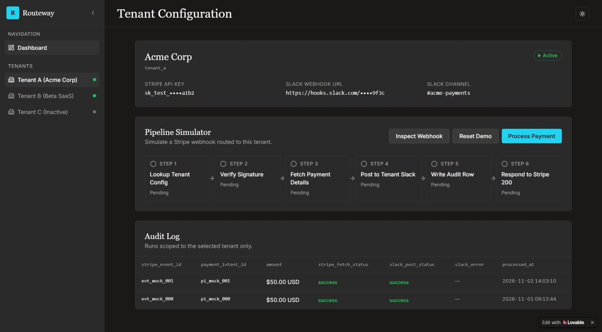</a> <b>9. Routeway</b></td>
    <td width="50%" align="center"><a href="https://workflow-health.lovable.app">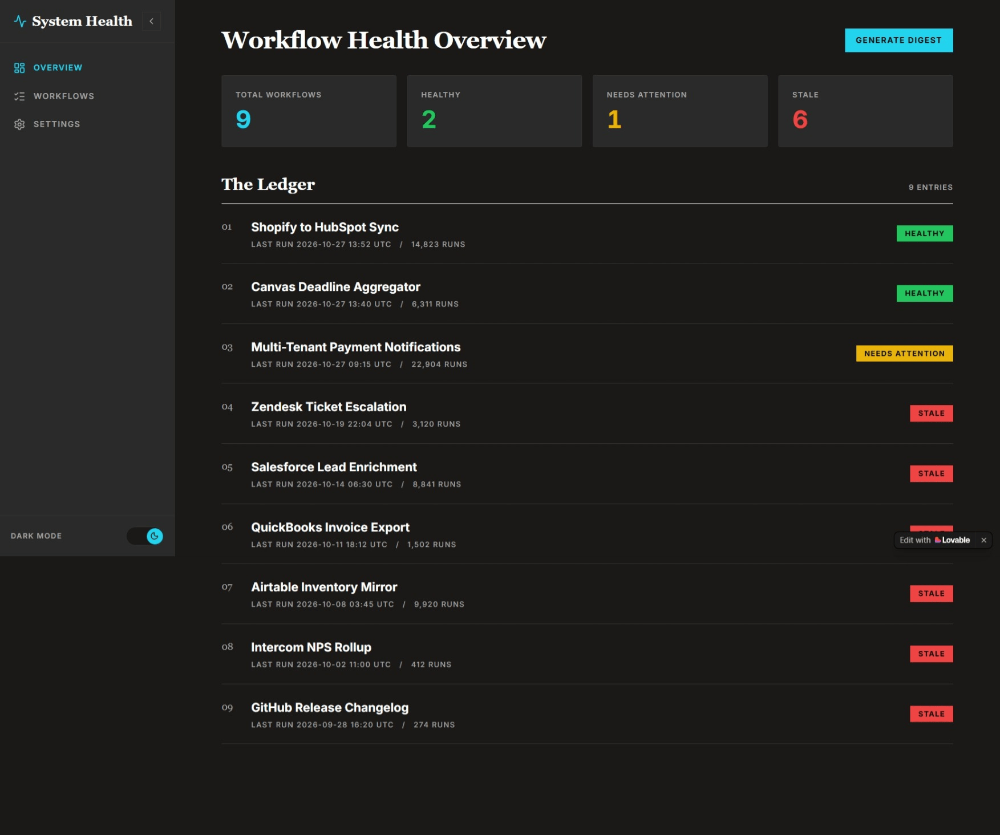</a> <b>10. Workflow Health</b></td>
  </tr>
</table>

## The Suite

| # | Workflow | App | Live Demo | Repo |
|---|----------|-----|-----------|------|
| 1 | HubSpot Lead Enrichment | Lead Enrichment Pipeline | [Live](https://lead-enrichment-pipeline.lovable.app) | [Repo](https://github.com/Xhenzouu/lead-enrichment-pipeline) |
| 2 | Shopify Order Confirmation | Triagedesk | [Live](https://triagedesk.lovable.app) | [Repo](https://github.com/Xhenzouu/triagedesk) |
| 3 | Shopify to HubSpot Sync | GetSync Command | [Live](https://getsync-command.lovable.app) | [Repo](https://github.com/Xhenzouu/getsync-command) |
| 4 | Airtable Notion Sync | Airtable Notion Diff | [Live](https://airtable-notion-diff.lovable.app) | [Repo](https://github.com/Xhenzouu/airtable-notion-diff) |
| 5 | Stripe Payment Fan-Out | Stripe FanOut | [Live](https://stripe-fanout.lovable.app) | [Repo](https://github.com/Xhenzouu/stripe-fanout) |
| 6 | Google Calendar to Slack Sync | SyncHealth | [Live](https://google-slack-sync.lovable.app) | [Repo](https://github.com/Xhenzouu/google-slack-sync) |
| 7 | Spreadsheet Consolidation | Data Ingest | [Live](https://data-ingest.lovable.app) | [Repo](https://github.com/Xhenzouu/data-ingest) |
| 8 | Canvas Deadline Aggregator | Canvas Deadlines | [Live](https://canvas-deadlines.lovable.app) | [Repo](https://github.com/Xhenzouu/canvas-deadlines) |
| 9 | Multi-Tenant Payments | Routeway | [Live](https://routeway-multi-tenant.lovable.app) | [Repo](https://github.com/Xhenzouu/routeway-multi-tenant) |
| 10 | Portfolio Health Monitor | Workflow Health | [Live](https://workflow-health.lovable.app) | [Repo](https://github.com/Xhenzouu/workflow-health) |

## Design System

Every app in this suite shares the same design language:

- Flat charcoal (`#1A1918`) background with solid surfaces (`#2A2A2A`)
- Serif headers (Georgia) with sans-serif data (Inter)
- Solid accent colors (cyan `#22D3EE`, purple `#A855F7`)
- No gradients, no glows, no emojis
- Full Light and Dark mode support
- Collapsible sidebar navigation with a consistent collapse chevron

## About

Built by Henson Brix A. Arroyo.

- GitHub: [@Xhenzouu](https://github.com/Xhenzouu)
- Portfolio: [hensonbrix-portfolio.vercel.app](https://hensonbrix-portfolio.vercel.app)
- Email: arroyobrix@gmail.com
